# Swiperia

Swiperia is an iOS game built around swipe gestures: an arrow appears on an
orb and you have to swipe in its direction before the time runs out. Play
alone or against friends nearby. Multiplayer runs over Bluetooth or local
Wi-Fi (Apple Multipeer Connectivity), no internet needed. In multiplayer you
generate and fire items at your opponent: an earthquake shakes the arrows, a
blizzard blocks the view, the screen turns upside down, the swipe direction is
reversed, or the time per swipe is halved.

  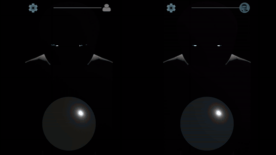

## Screenshots

| Game | Combo | Mistake | Item ready |
|:-:|:-:|:-:|:-:|
| 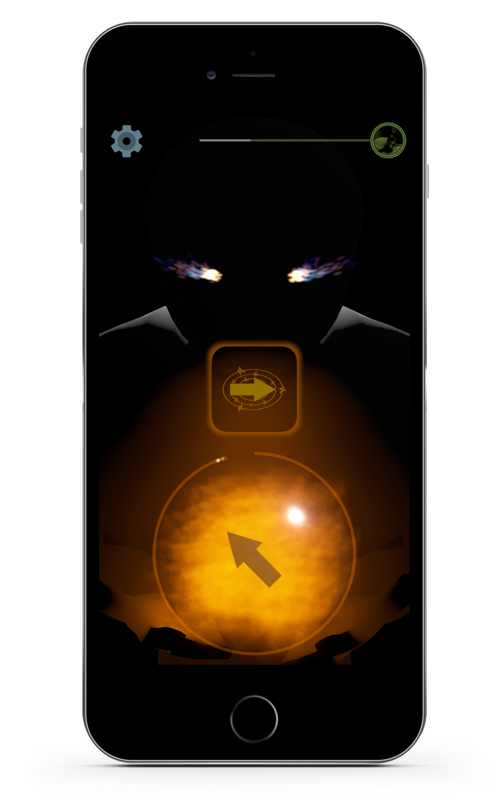 | 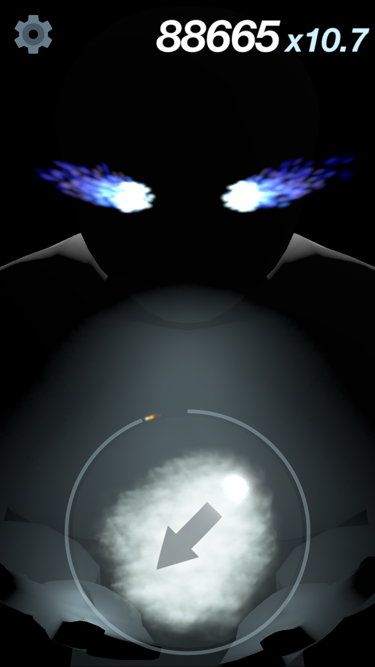 | 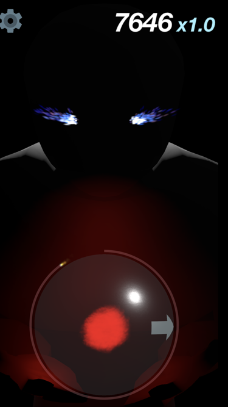 | 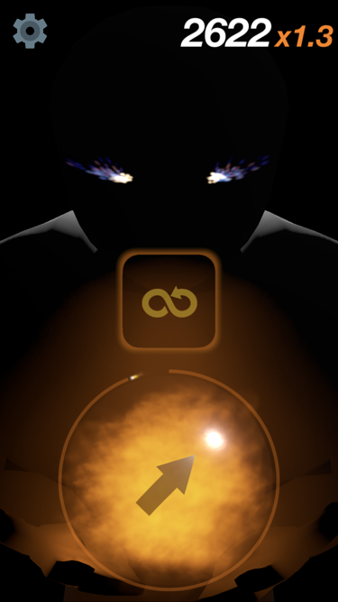 |

| Game selection | Game browser | Create lobby | Lobby |
|:-:|:-:|:-:|:-:|
| 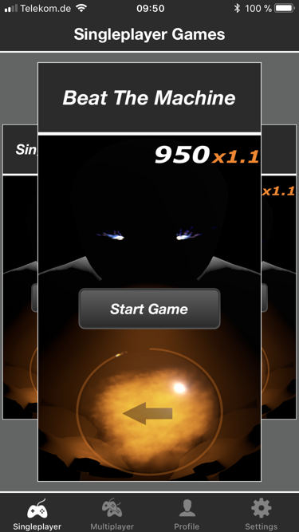 | 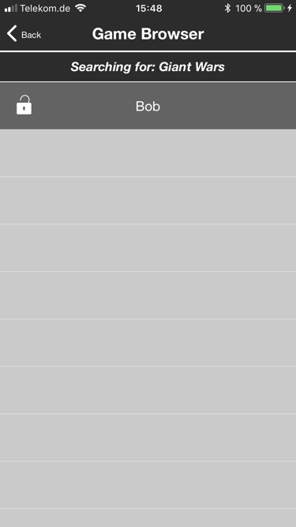 | 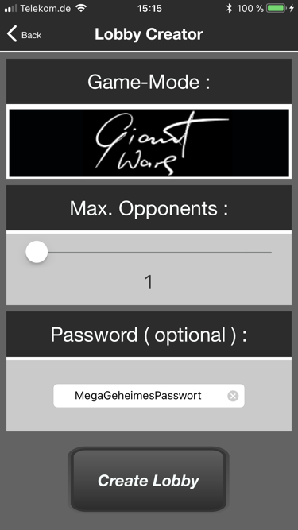 | 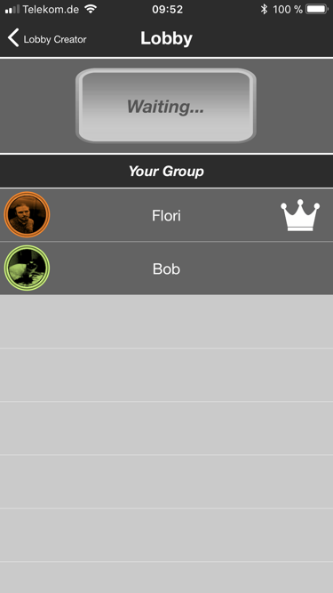 |

| Profile | Settings | Item list |
|:-:|:-:|:-:|
| 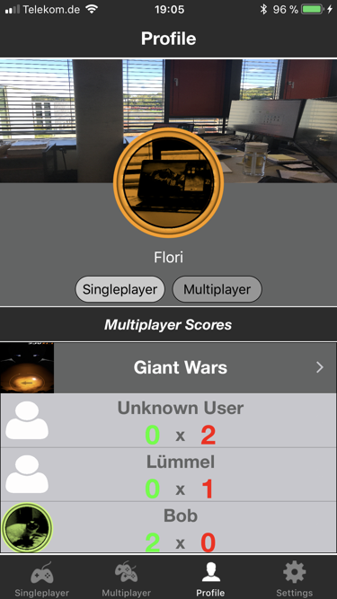 | 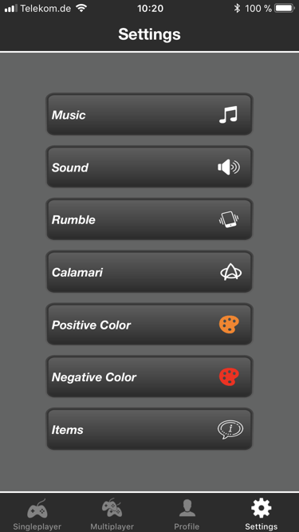 | 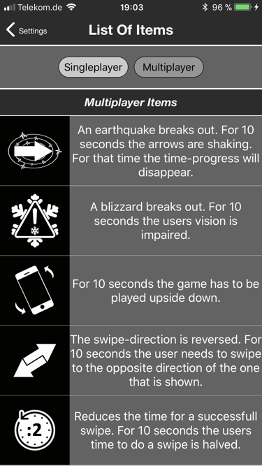 |

## How to play

An orb shows an arrow. Swipe in its direction, then the next arrow appears.

- **Time bar:** every game starts with a 10-second time bar that is refilled
  after each swipe. A wrong or missed swipe takes one second off the bar for
  the rest of the game. When the bar runs out, the game is over.
- **Combos:** correct swipes in a row raise the combo level (the first level
  after 5 swipes, each further level needs 1.5 times as many). The score
  multiplier rises with each level, up to ×2.3. From level 2 on, every new
  level gives one second back.
- **Items:** correct swipes charge the orb. When it is full (20 swipes in
  single player, 15 in multiplayer) you get a random item and activate it with
  a tap. Every item lasts 10 seconds.
- **Giant Wars (multiplayer):** your opponent appears as a giant whose health
  bar is their remaining time. Every mistake costs you time, every combo gives
  some back, and items you fire hit your opponent. Whoever runs out of time
  first loses; wins and losses per opponent are saved in the profile.

## Items

| | Item | Mode | Effect (10 seconds) |
|---|---|---|---|
|  | Same direction | Single player | The swipe direction is frozen, you only need to swipe one way |
| 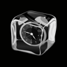 | Freeze time | Single player | The time bar stops (wrong swipes still cost time) |
|  | Reverse direction | Multiplayer | The opponent has to swipe against the arrow |
|  | Half arrow time | Multiplayer | The opponent has less time per swipe |
|  | Earthquake | Multiplayer | The opponent's arrows shake and the time bar disappears |
|  | Blizzard | Multiplayer | Snow covers the opponent's screen |
|  | Turn around | Multiplayer | The opponent's game is turned upside down |

## Context

Student project in the elective module *Fullstack iOS Entwicklung mit Swift*
(Medieninformatik Master, TH Köln, summer term 2017), supervised by
Alexander Dobrynin. Developed by Dennis Dubbert and Edgar Gellert. The game was
presented with this [poster](docs/poster.jpg).

The code was originally written in the `swiperia/` folder of the course
repository. That history (May to October 2017) is preserved in this repo.

## Features

- Single player: *Beat the Machine*, swipe against the clock
- Multiplayer: *Giant Wars* over Multipeer Connectivity, with lobbies,
  password protection and pause/resume (a second mode, *Sequence Breaker*,
  was planned but not finished)
- Item system with seven items, each with its own visual effect
- Profile with generated avatar (colour picker) and saved single and
  multiplayer results
- Settings for music, sounds, vibration and the colours of the swipe feedback

## Architecture

A single Xcode project (UIKit, storyboards), roughly split into views,
controllers and models/managers:

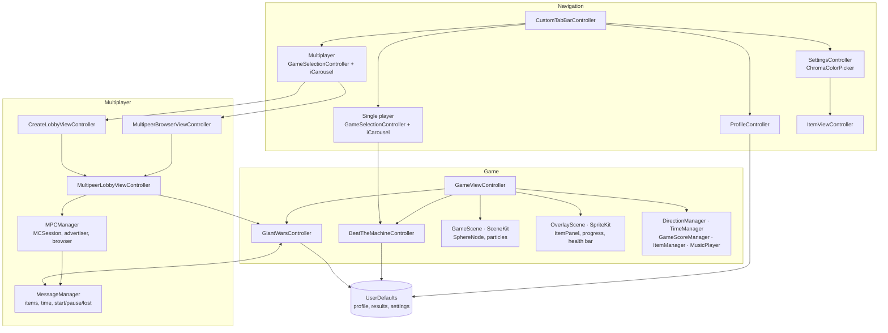

- **Game loop:** `GameViewController` holds the shared logic (swipe handling,
  timers, combo and item charge); the two game modes subclass it. The orb is a
  SceneKit scene, the HUD (item panel, progress, opponent health bar) a
  SpriteKit overlay on top.
- **Multiplayer:** each game mode advertises its own Multipeer service type;
  lobbies can require a password. `MessageManager` encodes typed messages
  (item fired, time changed, start, pause, resume, lost, kicked, avatar image)
  and forwards them to the running game via a delegate.
- **Persistence:** a `UserDefaults` extension stores the profile (generated
  avatar via `ProfileImageMaker`), single and multiplayer results and settings.

## Tech

Swift 3, UIKit with storyboards, SpriteKit and SceneKit particle effects,
Multipeer Connectivity, UserDefaults for persistence. Dependencies:
[iCarousel](https://github.com/nicklockwood/iCarousel) (vendored) and
[ChromaColorPicker](https://github.com/joncardasis/ChromaColorPicker) (CocoaPods).

## Building

Open `Swiperia/Swiperia.xcworkspace` in Xcode, select your own development
team under *Signing* and run on a device (multiplayer needs two devices).
The project dates from 2017 and has not been updated for current Xcode and
Swift versions.

## Status

Finished student project, not maintained. The original GitHub wiki was lost
when the course repository was deleted; the sections above were rebuilt from
the code and the project documentation.

## Licence

Code: [MIT](LICENSE). The background music (`Bass17w20.mp3`) and the 3D model
(`golem-radial/golem.obj`) were taken from free-to-use sources at the time and
are not covered by the MIT licence.
